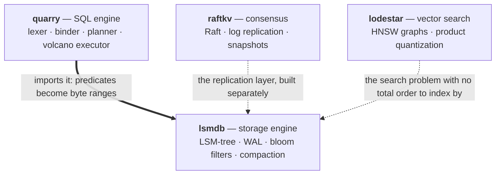

## Dhananjay Narayan

Backend and distributed systems. B.Tech CSE at **PES University**, Bengaluru (2023–2027).

I learn a system by building it from the bottom up with no dependencies — then benchmarking it,
breaking it on purpose, and writing down what it actually cost. Four of the repositories below are
the layers of a database, taken one at a time.

The solid edge is a real dependency — quarry is built on lsmdb and cannot run without it. The dotted
ones are not yet wired: raftkv replicates its own store, and putting lsmdb underneath it is the
obvious next step rather than something already done.

| Project | What it is | Measured |
|---|---|---|
| **[lsmdb](https://github.com/dhananjaypesu/lsmdb)** | LSM-tree storage engine — skip-list memtable, CRC'd write-ahead log with torn-tail recovery, bloom-filtered SSTables, leveled compaction, MVCC snapshots | 387K writes/s, 530K reads/s, 4.5× write amplification. Batching one 3 ms fsync across 100 writes raised durable throughput **90×** |
| **[quarry](https://github.com/dhananjaypesu/quarry)** | SQL database on top of lsmdb — lexer, Pratt parser, binder, access-path selection, volcano executor, transactions | 106K rows/s load, 120K point lookups/s. Order-preserving key encoding is what lets a `WHERE` clause become a byte range |
| **[raftkv](https://github.com/dhananjaypesu/raftkv)** | Raft consensus from scratch — leader election, log replication, snapshotting, linearizable reads via ReadIndex | **15×** write throughput (322 → 4,870 ops/s) after finding an fsync held inside the consensus lock |
| **[lodestar](https://github.com/dhananjaypesu/lodestar)** | Approximate nearest-neighbour search — HNSW graphs, product quantization, lock-free concurrent search | Exact top-10 **951×** faster than brute force at 91% recall; still **198×** faster at 100% |

All four are Go with **zero external dependencies**, tested under the race detector in CI.

### How I test

Correctness claims in these repos are checked against an independent oracle rather than against the
system itself, because a system that is consistently wrong passes its own assertions:

- **lsmdb** runs 30,000 random operations against a plain Go map and requires agreement three times
  over — live, after compaction, and after a simulated crash and recovery.
- **quarry** runs 3,000 random SQL statements against a Go map, cross-checking every state through a
  full scan, an index scan, and a key range.
- **raftkv** injects network partitions and node crashes deterministically, proving a
  minority-partitioned leader can never commit and that logs reconverge after a heal.
- **lodestar** scores every recall assertion against brute-force ground truth.

The measurement I most enjoyed finding: in lodestar, a product-quantized index's recall **does not
respond to search effort at all** — flat across 16× the work — because the limit is the compressed
codes, not the graph walk. Rescoring survivors exactly turns the same curve into 0.26 → 0.96. Two
independent error sources, and only one of them is worth spending on.

### Tools

- **Languages** Go · Java · Python · C++ · JavaScript · SQL
- **Systems** concurrency and the race detector · profiling · benchmarking · distributed systems · Docker · Linux
- **Web & data** Node.js · Express · React · PostgreSQL · MongoDB · Redis · pandas · scikit-learn

### Elsewhere

Bengaluru, India · [Website](https://dhananjaypesu.github.io) · [LinkedIn](https://www.linkedin.com/in/dhananjay-narayan-938869444) · [narayandhananjay7@gmail.com](mailto:narayandhananjay7@gmail.com)

Looking for **backend / SDE internship and new-grad** roles.
